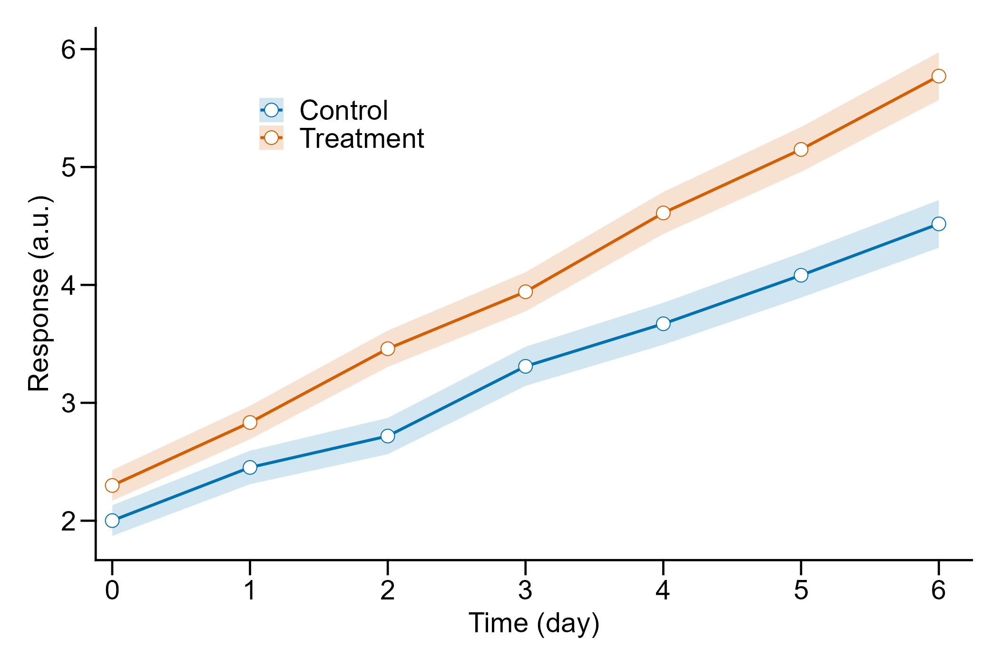

# r-paper-figures

**用 R 出期刊图，让屏幕预览和最终交付的文件长得一模一样。**

一个 AI Agent 技能（Skill）：把"论文配图必须满足的硬规格"和"预览为什么骗你"这两件事固化成可执行的工作流，而不是每次让模型凭记忆推断。



---

## 它解决什么问题

在 RStudio 里看着正常的图，`ggsave()` 之后尺寸、字号、字体、线宽全变了，投稿被退。根因几乎从不是 R 的 bug，而是**同一张图被两套参数渲染了两次**——屏幕设备一套，文件设备一套。

这个技能的做法：把宽度、高度、dpi、基础字号、字体族收进一个 `fig_spec()` 对象，让预览与保存读同一个对象；出图后用独立校验器解析 TIFF 的 IFD 标签，验证 LZW、dpi、物理尺寸是否真的达标。

## 快速开始

```r
source("scripts/bootstrap.R")   # 唯一入口，不要直接 source fig_spec.R

spec <- fig_spec(journal = "nature", column = "single", content = "line")
# → 89 × 59.333 mm, 600 dpi, 7 pt, Arial

p <- ggplot(dt, aes(x, y, colour = grp)) +
  geom_line(linewidth = lw(1.0)) +
  geom_point(size = 1.2) +
  geom_text(aes(label = lab), size = pt(7)) +   # 注意：不是 size = 7
  theme_pub(spec)

preview_pub(p, spec)                   # 与保存同参数渲染
save_pub(p, "output/fig01.tiff", spec) # TIFF + LZW + 白底
check_tiff("output/fig01.tiff", spec)  # 解析 IFD，反算物理尺寸
```

校验任意已有图件（不加载绘图栈，只需 base R）：

```bash
Rscript scripts/check_tiff_cli.R output/*.tiff --width 89 --dpi 600
Rscript scripts/check_tiff_cli.R output/*.tiff --json      # 供程序消费
```

## 三个致命单位陷阱

| 位置 | 单位 | 想写 8 pt |
|---|---|---|
| `theme(element_text(size = ))` | pt | `size = 8` |
| `geom_text()` / `annotate()` 的 `size` | **mm** | `size = pt(8)`；直接写 8 会得到约 22.7 pt |
| `linewidth` | **mm** | `linewidth = lw(0.75)`；直接写 1 会得到约 2.83 pt |

还有一个更隐蔽的：`ggsave(width = 7)` 默认单位是**英寸**，7 in ≈ 178 mm，你以为画了单栏，实际是双栏宽。

## 实测验证

R 4.3.3 / ggplot2 4.0.3 / ragg 1.3.2 / Windows 11，六张图真实运行（数据由 `check_tiff()` 从 IFD 反算，不是照抄参数）：

| 图 | 像素 | 物理尺寸 | dpi | 压缩 | 大小 |
|---|---|---|---|---|---|
| 折线 + 误差带 | 2102 × 1401 | 88.985 × 59.309 mm | 600 | LZW | 143 KB |
| 柱 + 散点 | 2102 × 1401 | 88.985 × 59.309 mm | 600 | LZW | 117 KB |
| 箱线 + 抖动 | 2102 × 1401 | 88.985 × 59.309 mm | 600 | LZW | 136 KB |
| 热图 | 2125 × 1594 | 89.958 × 67.479 mm | 600 | LZW | 263 KB |
| 多面板 A/B/C | 4200 × 2645 | 177.800 × 111.972 mm | 600 | LZW | 488 KB |
| 中文标注 | 1889 × 1417 | 79.968 × 59.986 mm | 600 | LZW | 81 KB |

全部：TIFF 版本 42、RGB、8/8/8 位、SamplesPerPixel=3、无 alpha、物理尺寸误差 < 0.05 mm。

**预览一致性**用"解码最终 LZW TIFF 的像素 vs 同 spec 预览 PNG 的像素"比对（LZW 无损，故等价于交付文件本身），结果 `max_channel_difference = 0`，差异像素 0。

## 仓库结构

```
SKILL.md                        # 工作流与硬规则（WorkBuddy / DSH 读这个）
scripts/
  bootstrap.R                   # 加载入口，修正 locale 后再 source
  fig_spec.R                    # 规格 / 主题 / 保存 / 预览 / TIFF 校验
  check_tiff_cli.R              # 独立校验器，仅 base R
  examples.R                    # 六类图完整范例
  verify_pixels.R               # 像素级一致性证明
references/
  journal-specs.md              # 八家期刊栏宽/dpi/字号/线宽/字体
  unit-traps.md                 # 单位换算与"预览≠保存"的六个根因
  troubleshooting.md            # 11 条实测踩坑
assets/paper_figure_guide.html  # 面向作者的完整图文指南
```

## 装到你的 Agent 里

| 宿主 | 安装方式 |
|---|---|
| **WorkBuddy** | 解压到 `~/.workbuddy/skills/r-paper-figures/` |
| **DSH** (DeepSeek Harness) | `cp -r . ~/.agents/skills/r-paper-figures/` |
| **opencode** | `.opencode/commands/r-figures.md`，正文用 `@path` 引用 `SKILL.md` |

opencode 的适配文件见 `integrations/opencode/`。

## 期刊规格

支持的预设：`nature` / `science` / `elsevier` / `acs` / `ieee` / `cn_gb`。

| 期刊 | 单栏 | 1.5 栏 | 双栏 |
|---|---|---|---|
| Nature | 89 mm | 136 mm | 183 mm |
| Science | 55 mm | 90 mm | 120 mm |
| Elsevier | 90 mm | 140 mm | 190 mm |
| ACS | 82.6 mm | — | 177.8 mm |
| IEEE | 88.9 mm | — | 181 mm |
| 中文期刊 | 80 mm | — | 170 mm |

> **规格会变**：同一出版社不同子刊栏宽可能相差 5–10 mm。投稿前必须以目标刊最新 Guide for Authors 为准。

## 边界

- R 只能输出 sRGB/RGB，需要 CMYK 时在外部转换（Photoshop / ImageMagick），转换后必须目视复核。
- TIFF 是位图，不存在字体嵌入问题，但文字不可编辑；期刊要求可编辑文字时需另附矢量版。
- 若目标刊明确"不接受 TIFF"或图为纯线条图，应改出 PDF/EPS，本仓库的 TIFF 参数不适用。

## License

MIT
